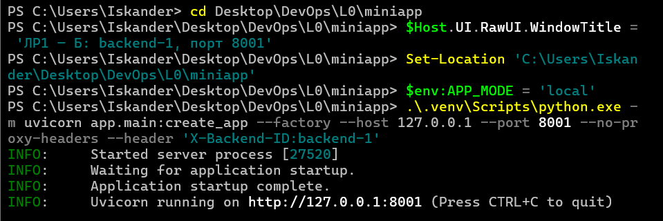
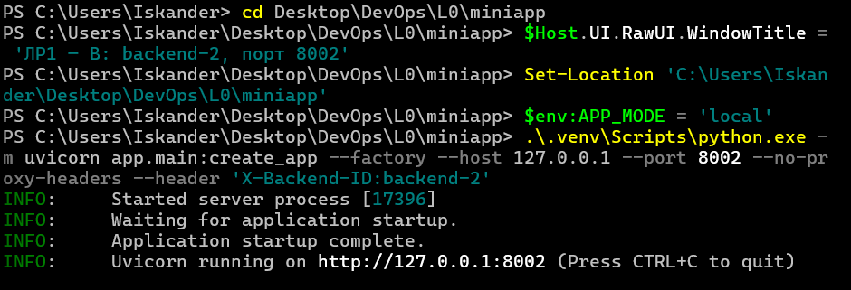
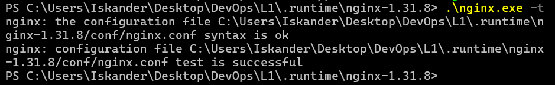
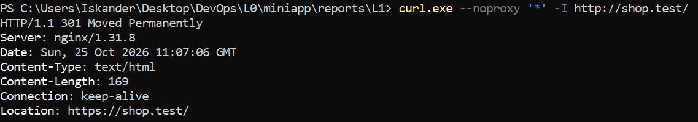
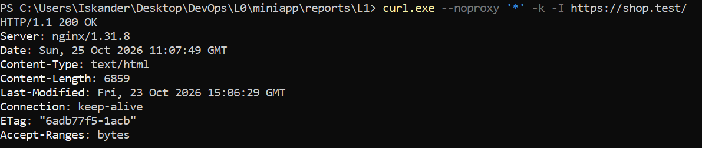
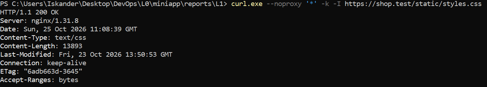
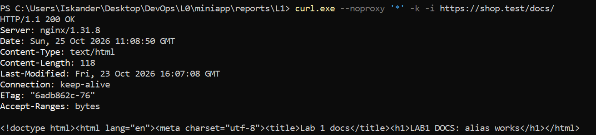
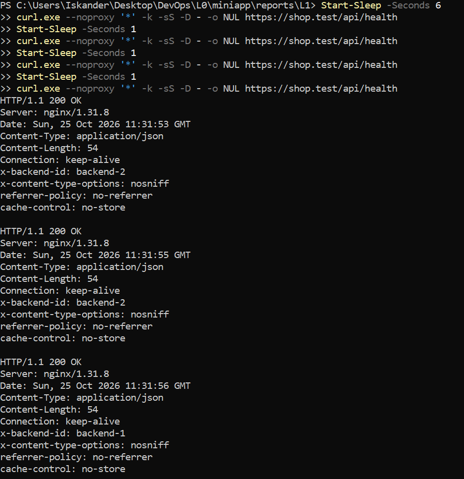

В ходе лабораторной работы я проверял, останется ли магазин доступным, если остановить один из бэкендов. Задача состояла в том, чтобы отключить одну из копий приложения и посмотреть, сможет ли вторая продолжить работу.

Я выполнял работу на Windows через PowerShell.

Обе копии приложения работали с одной базой. Поэтому переключение между ними не означало переключение на другой каталог. На `second.test` я разместил отдельную страницу, чтобы проверить работу двух сайтов на одном компьютере.

Два бэкенда я различал по заголовку `X-Backend-ID`. Для первого при запуске Uvicorn использовал параметры:

```powershell
--port 8001 --header 'X-Backend-ID:backend-1'
```

Для второго указал порт `8002` и значение `backend-2`.



*Первый бэкенд: приложение успешно запустилось на 8001 с идентификатором backend-1*



*Второй бэкенд: отдельный процесс на 8002, идентификатор – backend-2*

## Сначала проверил обычную работу

HTTP-запросы на порт 80 я перенаправил на HTTPS, порт 443. Сертификат создал самостоятельно для `shop.test` и `second.test`. Страницы, CSS и картинки отдавал nginx, а запросы `/api/` передавал в FastAPI.

Для совместимости с локальным режимом MiniApp nginx передавал внутренний Host `127.0.0.1` и убирал Origin. Сам nginx слушал только `127.0.0.1`.



*Перед запуском я проверил конфиг командой `nginx.exe -t`: синтаксис корректен, проверка успешна*

Я проверял код ответа и содержимое. Например, второй домен должен был показывать свою страницу, а не просто открываться.



*HTTP-запрос получил 301, а заголовок указал на `https://shop.test/`*



*Главная страница доступна через HTTPS: nginx вернул `200 OK`*



*Для CSS я получил `200 OK` и `Content-Type: text/css`*



*По адресу `/docs/` открылась отдельная учебная страница: `LAB1 DOCS: alias works`*


*Запрос `/api/products` к `second.test` получил `404`, так как API магазина не выдается на втором домене*


*Для `unknown.test` я также получил `404`, без содержимого магазина*


*Несуществующий путь вернул код `404` и мою страницу с текстом `LAB1: PAGE NOT FOUND`*


*Без пароля `/admin` ответил `401 Unauthorized` и запросил Basic Auth*


*После ввода пароля пользователя `student` я получил `200 OK` и `LAB1 ADMIN: access granted`*

Для проверки балансировки я отправлял GET-запросы с секундной паузой. В ответах идентификаторы менялись между двумя бэкендами.


После обычных проверок я остановил бэкенд на `8001`. nginx и PostgreSQL продолжали работать. Здесь я проверял потерю одной копии приложения.


*В терминале первого бэкенда появились `Application shutdown complete` и `Finished server process`*

Сначала nginx не дождался подключения к первому бэкенду, а затем он обратился ко второму и получил `200`. Сам посетитель тоже получил `200`. Каталог загрузился, заказ был создан, запрос истории выполнился успешно.

При повторной проверке я снова остановил только первый бэкенд. Порт `8001` перестал прослушиваться, а запросы через nginx получили `200` от `backend-2`. Каталог тоже вернулся с кодом `200`. Новые заказы при этой проверке я не создавал.


*Проверка порта показала `False`. Два запроса `/api/health` и запрос `/api/products` получили `200 OK` от `backend-2`*


*Во время проверки с остановленным первым бэкендом я открыл MiniApp на `shop.test`*


Потом я перезапустил первый бэк. Оба идентификатора снова появились в ответах. Перезапуск nginx для восстановления балансировки не понадобился.


*Первый бэкенд снова запущен на `8001` и принимает запросы*



*После шестисекундной паузы в ответах снова видны оба идентификатора*

Я настроил среднюю частоту 5 API-запросов в секунду и небольшой запас для коротких серий. Затем отправил 40 параллельных запросов к `/api/health`.


Через три секунды обычный запрос снова получил `200`, то есть блокировка пользователя не происходила


*После `Start-Sleep -Seconds 3` обычный запрос снова получил `200 OK`.*
## Итог

Я проверил, что магазин может пережить остановку одного бэкенда. В таком случае nginx переключается на оставшийся, API продолжает отвечать. При восстановлении сервера распределение запросов возвращается.