В ходе лабораторной работы я упаковал магазин «Теплое зерно» в Docker и подготовил запуск всего стека через Docker Compose. Для бэкенда сделал два образа: плохой с неудачными настройками и хороший, в котором эти проблемы исправлены.

Я выполнял работу на Windows через PowerShell. В стеке использовал FastAPI, nginx и PostgreSQL. Docker Desktop запускал Linux-контейнеры.

Сборку описал в [Dockerfile.bad](../../Dockerfile.bad) и [Dockerfile.good](../../Dockerfile.good), сервисы – в [docker-compose.yml](../../docker-compose.yml). Для ограничения контекста сборки использовал [.dockerignore](../../.dockerignore).

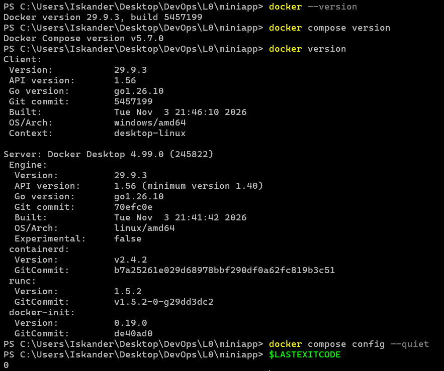

*Docker доступен из PowerShell, конфигурация Compose проходит проверку*

## Сначала сравнил Dockerfile

В плохом варианте использовал `python:3.12`. Этот тег фиксирует только ветку Python, но не конкретную patch-версию и вариант системы. Все файлы разрешенного контекста копировал до установки зависимостей:

```dockerfile
COPY . .
RUN pip install -r requirements.txt
```

Из-за такого порядка изменение кода делает слой установки зависимостей неактуальным. Контейнер запускается от `root`, проверка состояния приложения отсутствует. Сборка выполняется в одну стадию на полном базовом образе, а кеш pip остается внутри образа

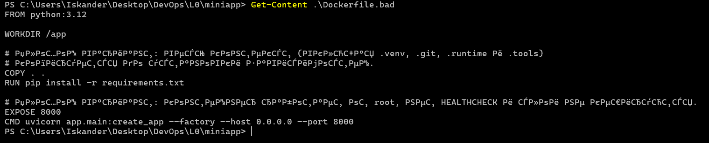

*Плохой Dockerfile: плавающий тег, запуск от root, COPY перед установкой зависимостей и отсутствие HEALTHCHECK*

В хорошем варианте зафиксировал базовый образ `python:3.12.8-slim-bookworm`. Разделил сборку на стадии `builder` и `runtime`: зависимости устанавливаются в виртуальное окружение, затем оно переносится в итоговый образ. В runtime копируются каталоги приложения, каталога товаров и статических файлов.

Сначала копируется `requirements.lock.txt` и устанавливаются зафиксированные зависимости. Исходный код копируется позже, поэтому его изменение не требует повторной установки библиотек. Кеш pip отключен через `PIP_NO_CACHE_DIR=1`.

Для запуска создал обычного пользователя `appuser`. Добавил `HEALTHCHECK`, который обращается к `/api/health`, и записал команду запуска в exec-форме.

Файл `.dockerignore` исключает `.env`, виртуальные окружения, Git, локальные данные PostgreSQL, инструменты и отчеты из контекста сборки. Здесь он общий для двух Dockerfile, поэтому действует и на плохой образ. Отличие плохого варианта состоит в копировании всего оставшегося контекста, а хорошего – только нужных каталогов.

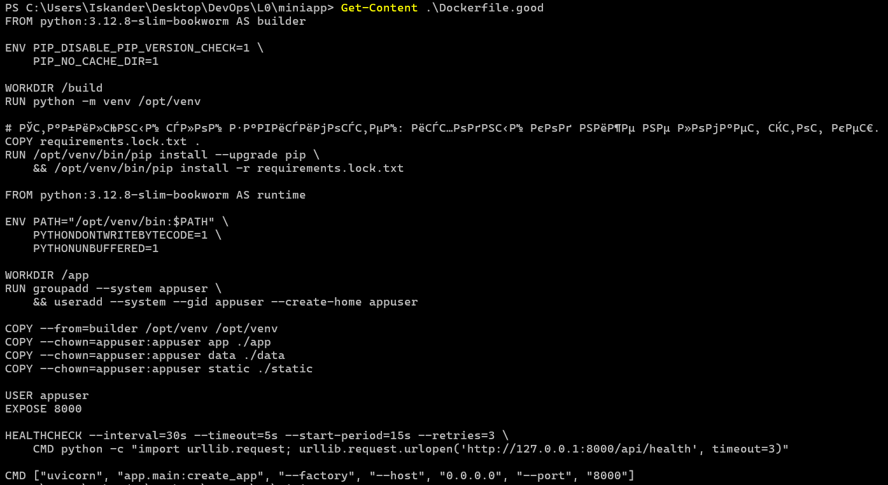

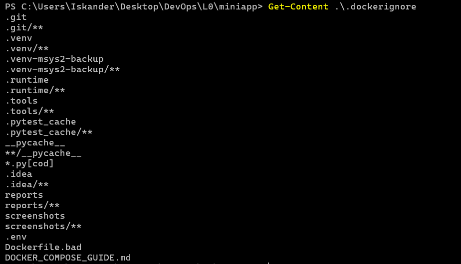

*Хороший Dockerfile использует multi-stage build, фиксированный базовый образ, отдельного пользователя, HEALTHCHECK и порядок слоев под кеш*

Размеры проверил через `docker image inspect`. Получил следующие значения:

| Образ | Размер, байт | Размер, МиБ |
| --- | --- | --- |
| `miniapp:bad` | 1 728 224 926 | 1648,16 |
| `miniapp:good` | 303 506 847 | 289,45 |
Хороший образ оказался в 5,7 раза меньше плохого. Основную разницу дают slim-основа и более ограниченный состав итогового образа.

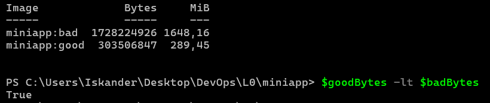

*Сравнение размеров miniapp:bad и miniapp:good на одной машине*

## Запустил весь стек одной командой

Для запуска использовал:

```powershell
docker compose up -d --build
```

Compose поднимает три сервиса: `frontend`, `backend` и `db`. nginx раздает HTML, CSS, JavaScript и картинки, а `/api/` передает FastAPI. Бэкенд обращается к PostgreSQL по имени `db` и порту `5432`.

У frontend опубликован порт `8080`. У backend и PostgreSQL опубликованных портов нет. Перед запуском frontend Compose ожидает готовности backend, а backend запускается после готовности базы.

Для статических файлов настроил отдельное сопоставление `/static/` с `/usr/share/nginx/html/`. Это сохраняет пути, которые уже используются в HTML и каталоге товаров.

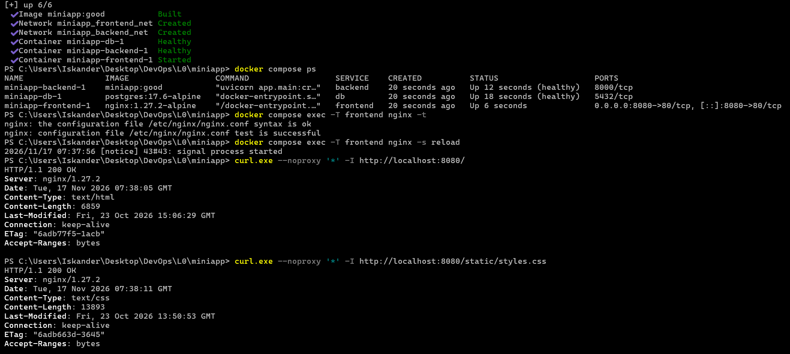

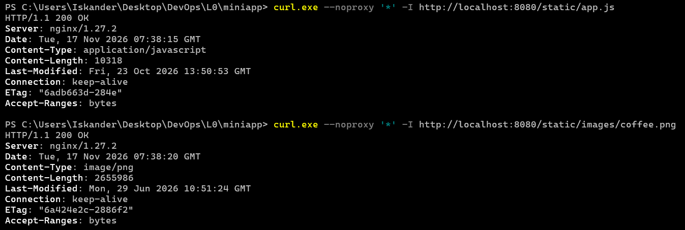

*Все три сервиса запущены, nginx отдает статические файлы с правильными типами содержимого*

Проверил пользователя работающего бэкенда:

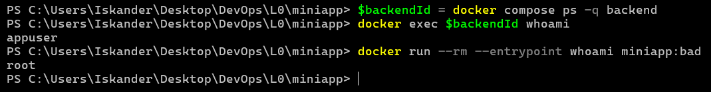

Запрос `/api/health` через frontend вернул `status: ok`, `database: postgresql` и `mode: compose`. Отдельно из backend выполнил `SELECT 1`: база вернула `(1,)`.

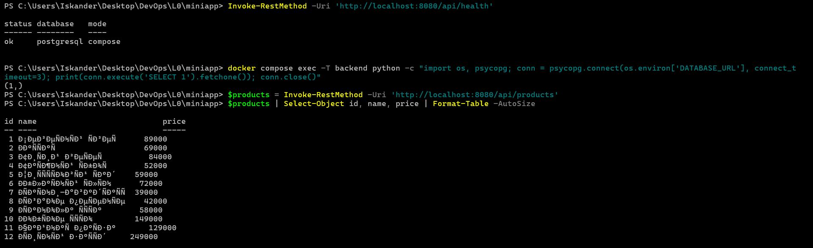

*Frontend получает ответ backend, а backend успешно обращается к PostgreSQL*

Открыл магазин на `http://localhost:8080`, добавил товар в корзину и оформил заказ. Магазин присвоил ему номер `1`. Он появился в разделе «Мои заказы» после обновления страницы.

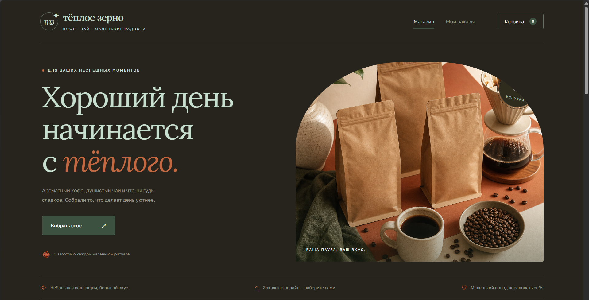

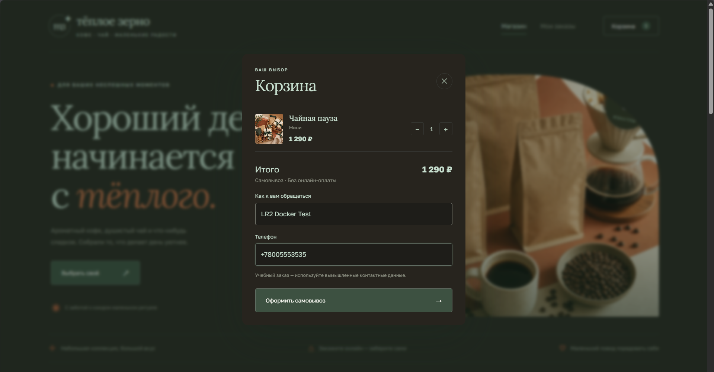

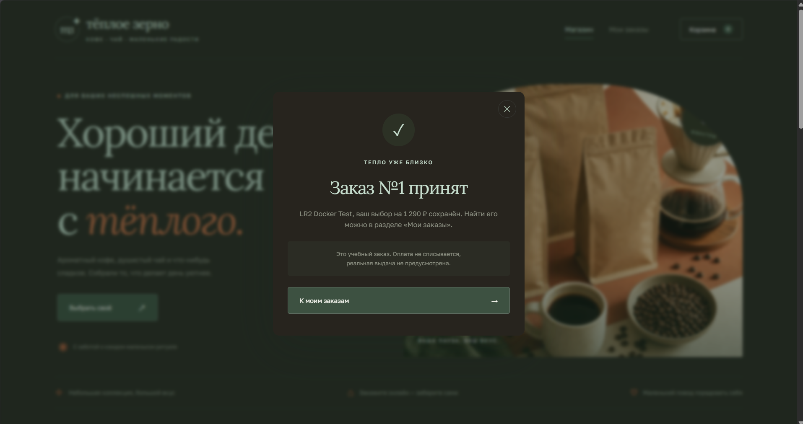

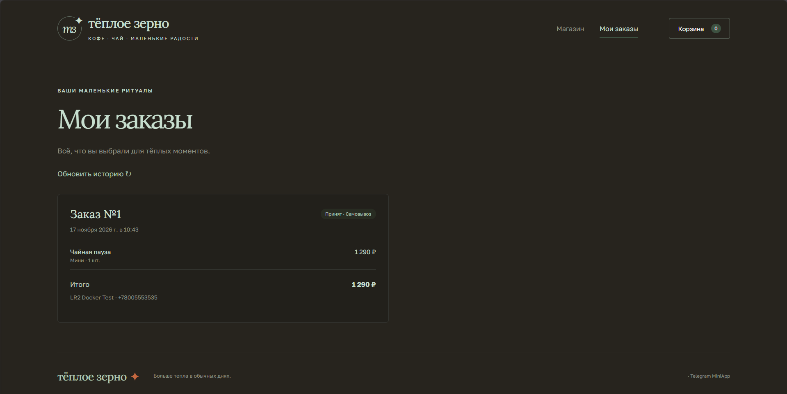

## Проверил кеш после изменения кода

Сначала собрал оба образа, чтобы у них появились кешированные слои. Затем изменил одну строку приложения и измерил повторную сборку через `Measure-Command`.
Для плохого образа использовал:

```powershell
Measure-Command { docker build --progress=plain --file Dockerfile.bad --tag miniapp:bad-cache . }
```

Для хорошего образа:

```powershell
Measure-Command { docker build --progress=plain --file Dockerfile.good --tag miniapp:good-cache . }
```

| Повторная сборка  | Время, с |
| ----------------- | -------- |
| `Dockerfile.bad`  | 39,751   |
| `Dockerfile.good` | 4,977    |

В плохом варианте изменение исходника затронуло `COPY . .`, после которого находится `pip install`. Поэтому установка зависимостей выполнялась заново.

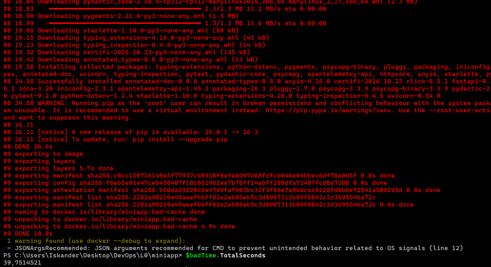

В плохом Dockerfile изменение кода приводит к повторной установке библиотек. В хорошем варианте слой установки зависимостей получил отметку `CACHED`. Изменились только более поздние слои с исходным кодом. После проверки вернул исходный файл приложения.

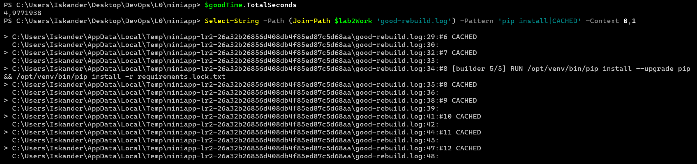

В этом замере хороший образ пересобрался примерно в 8 раз быстрее. Dockerfile также отличаются базовыми образами и способом задания зависимостей, поэтому всю разницу во времени нельзя приписывать только порядку слоев. Его влияние видно по повторному выполнению `pip install` в одном случае и использованию `CACHED` в другом.

## Проверил сетевую изоляцию

В Compose настроил две сети: `miniapp_frontend_net` и `miniapp_backend_net`. Frontend находится только в первой, PostgreSQL – только во второй. Backend подключен к обеим сетям и связывает HTTP API с базой.

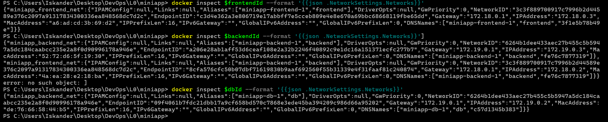

*Общей Docker-сети у frontend и db нет*

Из frontend попробовал открыть TCP-соединение с `db:5432`. Попытка завершилась ошибкой разрешения имени. Затем проверил соединение с фактическим IP контейнера базы `172.19.0.2`: оно завершилось тайм-аутом. В обоих случаях код выхода был `1`. При этом обращение backend к PostgreSQL оставалось успешным.

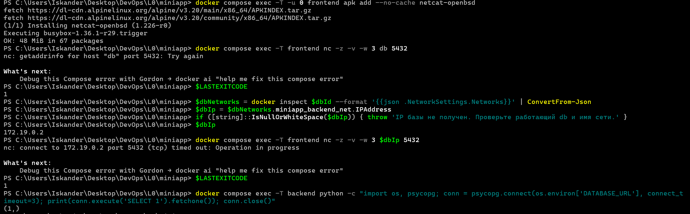

*Frontend не устанавливает прямое соединение с PostgreSQL*

## Проверил сохранение заказа после удаления контейнера

Данные PostgreSQL разместил в именованном томе `miniapp_pgdata`, подключенном к `/var/lib/postgresql/data`. До удаления контейнера записал ID тестового заказа: `1`. Проверил его через API и SQL-запрос: сумма составляла `129000` копеек, то есть 1290 рублей.

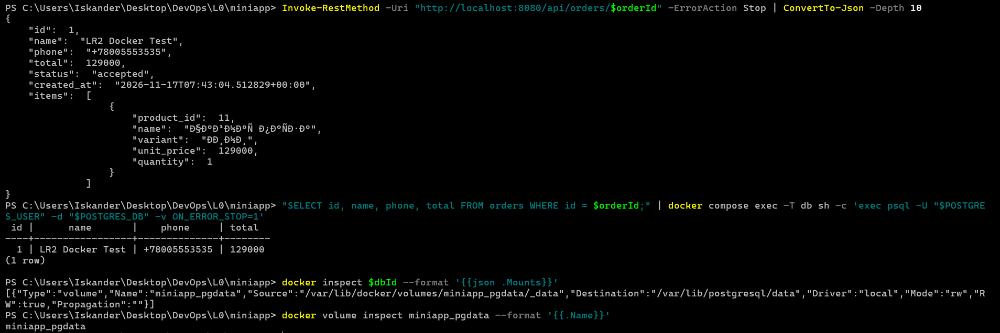

*Тестовая запись находится в PostgreSQL, данные контейнера хранятся в именованном томе*

Остановил контейнер `db` и удалил его через `docker rm`. Затем поднял базу снова через Compose. У старого контейнера ID начинался с `c57d1345b383`, у нового – с `f8de9764933e`. Сравнение подтвердило, что ID различаются, а том остался прежним.

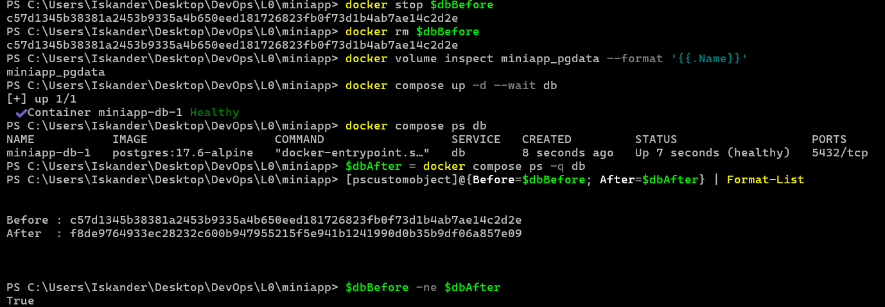

*Контейнер PostgreSQL пересоздан, именованный том сохранен*

Повторный SQL-запрос вернул заказ с тем же ID `1` и суммой `129000` копеек. API снова вернул `status: ok` и тот же заказ. Сравнение JSON до и после пересоздания дало `True`. Значит, запись пережила удаление контейнера базы без изменения содержимого.

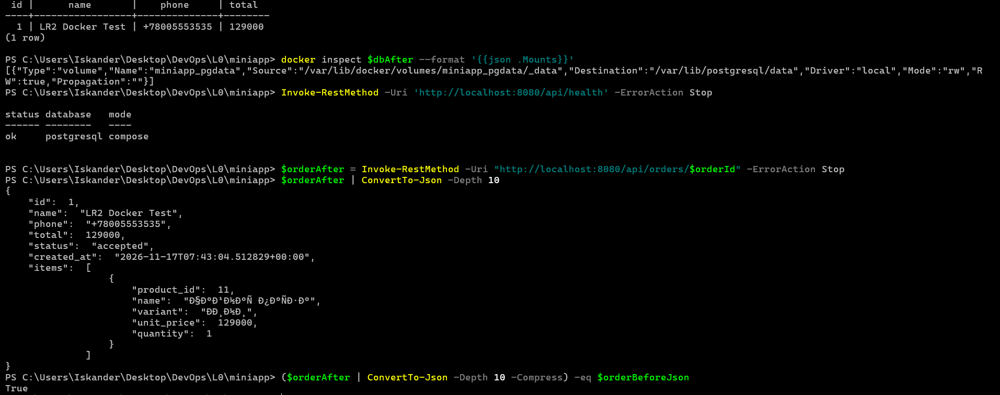

*Заказ сохранился после удаления и повторного создания контейнера PostgreSQL*

В конце остановил стек через `docker compose down`
## Итог

Я подготовил два Dockerfile и сравнил их размер, пользователя и использование кеша. Хороший образ запускает приложение от `appuser`, содержит HEALTHCHECK и использует отдельный слой зависимостей. Весь стек запускается одной командой Compose. PostgreSQL сохраняет заказы в именованном томе, а frontend обращается к базе через backend.
